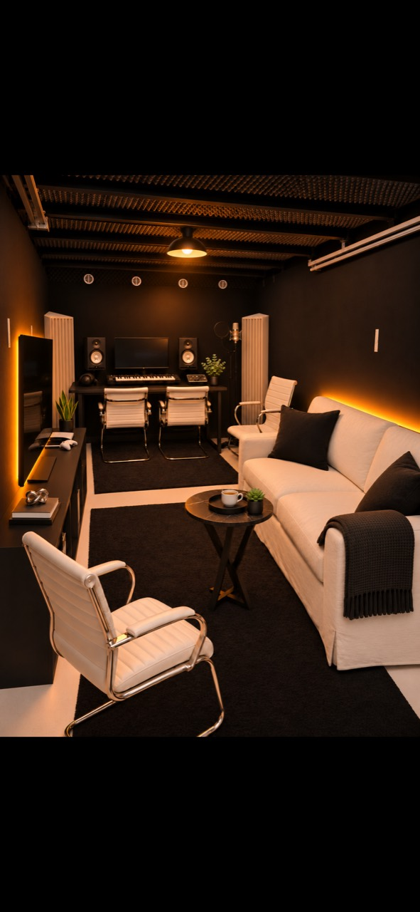
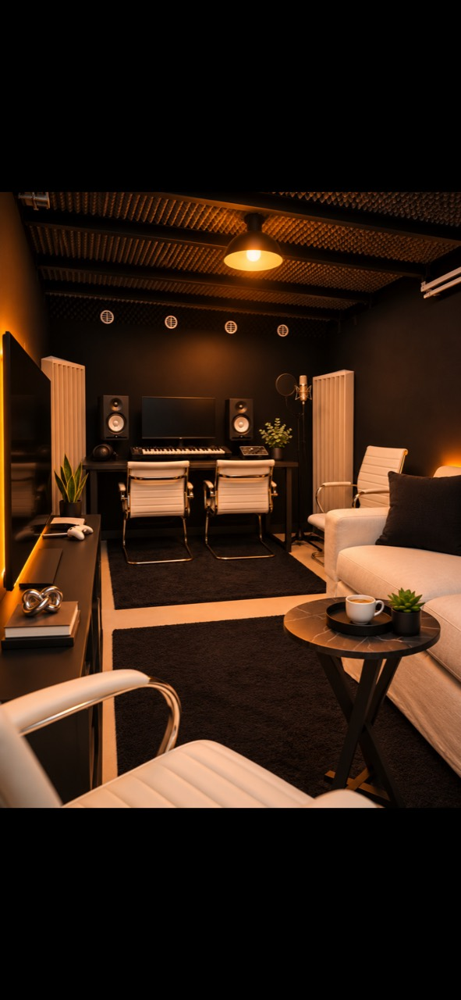
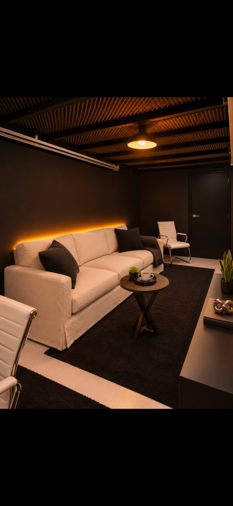
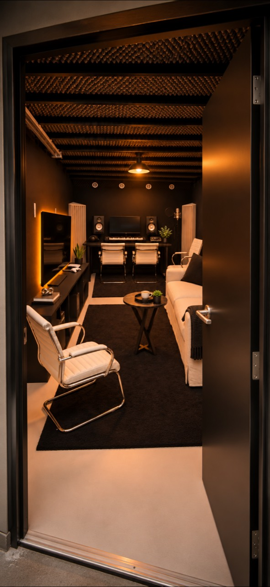

# Inside the Studio

Mijn Digital Garden over mijn eigen muziekstudio. Hier maak ik beats, neem ik vocalen op en mix en master ik tracks. In deze Learning Log leg ik vast hoe ik die ruimte en mijn manier van werken vertaal naar het web.

- [Website](https://inside-the-studio.nl)
- [GitHub-repository](https://github.com/ssam111/inside-the-studio)

## Week 0 · 9–13 november 2026

### Project opzetten

De GitHub-repository is lokaal gekloond en geopend in VSCodium. Het domein `inside-the-studio.nl` is bij TransIP ingesteld met vier A-records voor GitHub Pages en staat in [CNAME](CNAME).

De lokale kopie liep één commit achter op GitHub. Op 19 november is `main` bijgewerkt naar commit `7ced313`. De uitgebreide lokale Learning Log en het bestaande screenshot zijn daarbij bewaard. Een eigen commit en push vanuit VSCodium moeten nog worden gecontroleerd.

### Overige opdrachten

| Opdracht | Stand van zaken |
| --- | --- |
| Zelftest | Resultaat en eigen leerpunt ontbreken nog. |
| Vier practica en huiswerk | Welke sessies je hebt gedaan en welk werk daarbij hoort, is nog niet bevestigd. |
| Schetsoefening | Foto van de uitgevoerde oefening ontbreekt nog. |
| Checkout | Eigen antwoorden ontbreken nog. De vragen gaan over je keuze voor GitHub, je domeinkoppeling en hoe je wijzigingen publiceert. |
| Reflectie | Concept op basis van het echte projectverloop staat hieronder. |

- [Sprint 0 in DLO](https://dlo.mijnhva.nl/d2l/le/lessons/759393/units/3130845)

### Reflectie · Week 0

_Concept met AI-hulp op basis van het projectverloop._

Ik heb veel tijd gestoken in het opzetten van mijn website. Het domein, de projectmap en GitHub waren uiteindelijk geregeld. Het verwarrendste moment was toen VSCodium nog mijn oude README liet zien, terwijl er op schijf al een nieuwe versie stond. Er zat nog tekst in mijn tab die ik niet had opgeslagen. Ook liepen mijn lokale project en GitHub op een gegeven moment uit elkaar. Een volgende keer wil ik na een kleine wijziging meteen kijken wat er in VSCodium staat, wat er op schijf staat en wat al online staat. Dan zie ik eerder waar het verschil ontstaat.

## Week 1 · 16–20 november 2026

### Onderwerp en sfeer

Mijn eigen studio is de plek waar dit project om draait. Het sfeerwoord is **flowstate**. Zoals ik het omschreef: ‘Alleen ik en de muziek zijn op de wereld.’ Op de website wil ik dat gevoel oproepen met één duidelijk focuspunt en genoeg ruimte om rustig te kijken.

### Mijn studio als beeldreferentie

Met de studiovisualisaties die ik later heb toegevoegd, heb ik de eerdere ideeën over focus, contrast en herhaling concreet gemaakt voor mijn eigen ruimte.

#### Zicht vanuit de zithoek

De donkere ruimte en het warme licht trekken je blik naar het bureau achterin. Het oranje licht vormt de basis voor het accent op de homepage.

#### Mijn werkplek

Het scherm en de twee monitoren vormen samen één groep. Op de website heb ik de opname- en productieapparatuur op dezelfde manier bij elkaar gezet.

#### De zithoek

De lichte bank valt op tegen de donkere wanden. Dat contrast komt terug in de themakleuren en helpt om werkplek en zithoek visueel van elkaar te onderscheiden.

#### Door de deuropening

Het deurkozijn omlijst het beeld en de lijnen van de ruimte leiden naar het bureau. Zo krijgt het idee van tunnelvisie een beeld uit mijn eigen project.

### CSS-proeven met AI-hulp

In de [CSS-proeven](oefeningen/css-proeven/index.html) staan twee radioknoppen voor een licht of donker thema en vier afbeeldingen voor de combinaties van schermbreedte en kleurvoorkeur, een radiale gloed, een herhalend patroon en een grid dat van één naar twee kolommen gaat. DLO vraagt voor Oefening 2 een kattenwinkel op basis van een CodePen-fork en voor Oefening 3 vier varianten van een hardloopbeeld. De lokale proeven testen dezelfde CSS-technieken met studiobeelden. Oefening 3 (lokaal in `oefeningen/responsive-hardloopbeeld/index.html`) is nu lokaal uitgewerkt met de Nike-foto uit het DLO-startpakket, in twee uitsneden en twee tinten. De CodePen-fork voor Oefening 2 staat nog open.

### Testresultaten

Chrome is getest met een lichte en een donkere kleurvoorkeur. Op 390 px toont de proef één kolom en de detailafbeelding. Op 1000 px toont de proef twee kolommen en de brede afbeelding. De themaschakelaar en beide gradients zijn ook gecontroleerd.

Ook de twee andere combinaties zijn in Chrome getest. Bij beide schermbreedtes kiest het picture-element het beeld dat bij de kleurvoorkeur past. Beide radioknoppen wisselen het thema van het voorbeeldblok.

### Opdrachten en bewijs

| Opdracht | Stand van zaken |
| --- | --- |
| Digital Gardens verkennen | Eigen observaties en bronnen ontbreken nog. |
| HTML-presentatie | [Remark-concept met AI-hulp](oefeningen/presentatie/index.html) met 14 slides, tien inhoudelijke bronlinks, een korte intro en een eigen studioslide. |
| Practicum Light & Dark Theme | [Oefening 1](oefeningen/light-dark-101/index.html) is lokaal uitgewerkt met AI-hulp. Beide thema’s zijn getest in Chrome. De CodePen-fork staat nog open. |
| Visual research | De beeldverzameling, terugkerende kenmerken en vier ontwerpvertalingen staan hierboven. |
| Crazy 8 | Foto van de acht ideeën ontbreekt nog. |
| Vijf mobiele homepageschetsen | Voor 20 november. Vijf varianten van dezelfde homepage in één kolom, gebaseerd op een Crazy 8-idee, met aantekeningen bij de keuzes. Foto’s ontbreken nog. |
| Practicum kleur, gradients en patronen | Twee werkende gradientproeven staan hierboven. De volledige DLO-eisen zijn nog niet gecontroleerd. |
| Reflectie | Concept over Flowstate en het beeldonderzoek staat hieronder. Reflectie op de schetsen volgt zodra die er zijn. |

- [Sprint 1 in DLO](https://dlo.mijnhva.nl/d2l/le/lessons/759393/units/3130841)
- [Huiswerk voor vrijdag](https://dlo.mijnhva.nl/d2l/common/dialogs/quickLink/quickLink.d2l?ou=759393&type=content&rcode=5A5AD6A8-DE14-49BB-9121-D347F48A3226-2572585)

### Reflectie · Week 1

_Concept met AI-hulp op basis van mijn omschrijving van Flowstate en het gemaakte beeldonderzoek._

Toen ik over flowstate vertelde, zei ik: ‘Alleen ik en de muziek zijn op de wereld.’ Dat gaf me een concretere richting dan alleen ‘muziekproductie’. In het beeldonderzoek vind ik vooral het verschil tussen donker en licht bruikbaar. In de visualisatie van mijn studio trekt het warme licht je blik naar de werkplek. In het beeld vanuit de deur versterkt het donkere kozijn die focus. Een idee voor mijn homepage is om één onderdeel meteen aandacht te geven, bijvoorbeeld met een verlicht studiobeeld. Bij het schetsen wil ik vergelijken of dat nog duidelijk is op een klein scherm, waar beeld en tekst onder elkaar staan.

## Maandag 23 november · Workshop 4

### Opdracht 16 · Naar een responsive design

De [Digital Garden](https://inside-the-studio.nl) is met AI-hulp opgebouwd vanuit het beeldonderzoek. De kop, intro en foto staan op mobiel onder elkaar. Vanaf 46 rem krijgt de foto een iets bredere tweede kolom, zodat het beeld groter kan zonder de tekstregel op te rekken. Dit is een digitale proef op basis van het beeldonderzoek. Er waren geen foto's van eigen schetsen beschikbaar.

Vergelijk in de duobespreking of het grote studiobeeld de tekst helpt of te veel aandacht trekt en of de overgang bij 46 rem natuurlijk voelt. Die duobespreking heeft hier nog niet plaatsgevonden.

In de [Digital Garden](https://inside-the-studio.nl) staat mijn eigen studio centraal. De intro vertelt kort dat ik beats maak, vocalen opneem en tracks mix en master. De details over mijn apparatuur staan verderop bij de inventaris. De zithoek staat er in algemene termen bij. De bass traps, het plafondfoam, de leds en de ronde tafel zijn details uit de visualisaties.

### Opdracht 17 · Voorbeelden voor de duobespreking

- [Mozilla](https://www.mozilla.org/en-US/) — vergelijk hoe het uitklapbare menu de hoeveelheid links hanteerbaar houdt.
- [Learn Responsive Design](https://web.dev/learn/design/) — bekijk hoe de reeks lessen geordend blijft bij verschillende breedtes.
- [De CSS-proeven in dit project](oefeningen/css-proeven/index.html) — vergelijk het geteste grid van één kolom op 390 px met twee kolommen op 1000 px.

Deze drie voorbeelden liggen klaar voor de bespreking. De klaskeuze en het gesprek met een ander duo zijn nog niet vastgelegd.

[Workshop 4 in DLO](https://dlo.mijnhva.nl/d2l/le/lessons/759393/lessons/3130878) · [Opdrachten 16 en 17](https://dlo.mijnhva.nl/d2l/le/lessons/759393/folders/3130898)

### Bi-weekly Geek 1 · Voorbereiding

De bronnen in DLO belichten drie kanten van het internet: de fysieke verbindingen, de afhankelijkheid van grote cloudbedrijven en de vraag wie invloed heeft op het web.

- De BBC-video is de kijkbron voor het verschil tussen een apparaat, het netwerk en de server die een antwoord terugstuurt. [BBC Click](https://www.youtube.com/watch?v=eHp1l73ztB8)
- De storing bij AWS laat zien hoe één leverancier meerdere ogenschijnlijk losse diensten tegelijk kan raken. [Analyse van The Guardian](https://www.theguardian.com/commentisfree/2025/oct/22/the-guardian-view-on-the-cloud-crash-an-outage-that-showed-who-really-runs-the-internet)
- Het interview met Tim Berners-Lee geeft aanleiding om te vragen wie bepaalt hoe het web zich ontwikkelt en hoeveel zeggenschap gebruikers zelf hebben. [Interview met Tim Berners-Lee](https://www.theguardian.com/technology/2026/jan/29/internet-inventor-tim-berners-lee-interview-battle-soul-web)

**Mogelijke hoofdvraag:** Welke verantwoordelijkheid heeft de overheid voor internetdiensten die burgers nodig hebben? Onderzoek welke openbare diensten bij een cloudstoring uitvallen, welke alternatieven er zijn en wie verantwoordelijk is voor herstel. Een bronnenvergelijking tussen een storingsverslag en een overheidsdocument kan technische oorzaken en verantwoordelijkheden uit elkaar houden.

Dit zijn voorbereidende notities met AI-hulp. Deelname aan de verplichte werkgroep of een eventuele handgeschreven herkansing is hier niet bevestigd.

### Check-out · Voorbeeldantwoorden

1. **Wanneer werkt de vormgeving niet meer?** Als een kop buiten het scherm valt, een foto te veel plaats inneemt of een tekstregel erg lang wordt. Laat tekst omslaan, begrens de regelbreedte en laat beelden meeschalen.
2. **Wat is de volgende responsive stap?** Controleer de proef rond het omslagpunt van 46 rem en bij ingezoomde tekst. Verplaats het omslagpunt als de tekst of de foto daar te krap wordt.
3. **Hoe is de Garden opgebouwd?** De proef gebruikt een mobile-first grid. Eerst staat alles in één kolom. Een media query geeft de foto op een breder scherm een tweede kolom. `clamp()` schaalt de titel mee en CSS-variabelen regelen de themakleuren.

Dit zijn antwoorden op basis van de gebouwde proef. De mondelinge toelichting blijft een eigen oefening. [Checkout in DLO](https://dlo.mijnhva.nl/d2l/common/dialogs/quickLink/quickLink.d2l?ou=759393&type=content&rcode=5A5AD6A8-DE14-49BB-9121-D347F48A3226-2558785)

### Grid 101 en Media Queries 101

De lokale Grid 101-proef (lokaal in `oefeningen/grid-101/index.html`) oefent vier onderwerpen uit het practicum met materiaal uit Inside the Studio. Het eerste raster laat kolommen, tussenruimte en overspannen zien. De kaarten gebruiken grid voor beeld, titel, tekst en link. Een media query zet bij de uitgelichte kaart het beeld naast de tekst op brede schermen. De verzameling kaarten krijgt met `auto-fit` extra kolommen zodra er ruimte is.

Deze uitwerking is met AI-hulp gemaakt. De officiële CodePen-starters zijn nog niet geforkt. [Practicum in DLO](https://dlo.mijnhva.nl/d2l/le/lessons/759393/lessons/3130875)

## Woensdag 25 november · Mijn Digital Garden online

De hoofdpagina staat op [inside-the-studio.nl](https://inside-the-studio.nl). De pagina heeft een korte intro, de apparatuur per groep en zes visualisaties van mijn studio. Op mobiel staat de intro boven het beeld. Op een breder scherm staan ze naast elkaar. Mijn kleurkeuze sluit aan op het warme licht in de ruimte.

De ontwerpprincipes uit de les helpen om die keuzes uit te leggen. Het donkere beeld geeft ruimte aan een duidelijk lichtpunt. Nabijheid groepeert apparatuur die ik samen gebruik. Het grid houdt de volgorde begrijpelijk wanneer de schermbreedte verandert.
